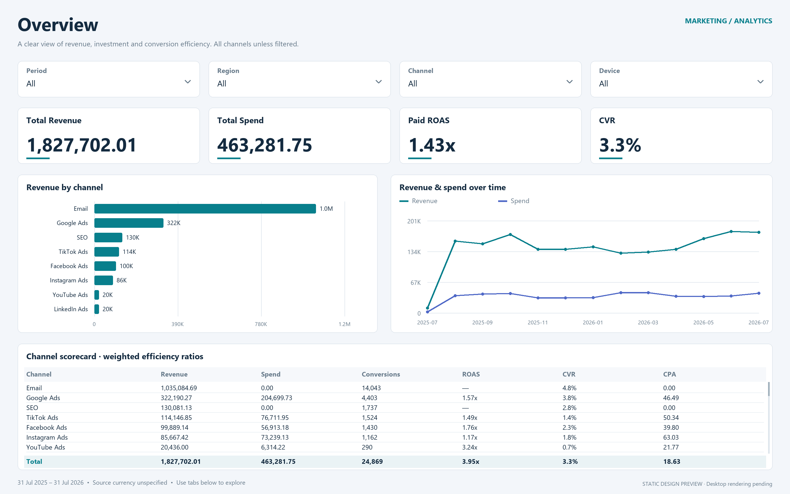

<<<<<<< HEAD
# Marketing Analytics · Power BI

A three-page marketing report built from the supplied SQL project and recovered Power BI data: 3,000 records across eight channels from 31 July 2025 to 31 July 2026.

**Delivery status:** editable native Power BI Project (PBIP), with schema and data checks completed. Power BI Desktop was unavailable during creation, so Desktop opening, refresh, visual rendering and interactions still require the local check below. SQL scripts were reviewed but not executed against SQL Server. The images below are data-backed static design previews, not Power BI screenshots.



## Open the dashboard

1. Download or clone the entire repository and keep its folders together.
2. In a recent Power BI Desktop version, open **`powerbi/Marketing.pbip`**. If the file association is unavailable, open `powerbi/Marketing.Report/definition.pbir` through Desktop.
3. Select **Refresh** to load the embedded snapshot. There is no SQL connection or personal file path to configure. The report uses native visuals and an included theme.
4. Check that Overview shows revenue **1,827,702.01**, spend **463,281.75**, paid ROAS **1.43x**, and CVR **3.3%** (display rounded to one decimal).
5. Select a period, region, channel and device; confirm charts and cards change. Each page has its own filters. Paid Performance has a fixed Paid page filter. Clear slicers before comparing the reference totals.
6. Save locally. To share a single report file, use Desktop **File → Save as → Power BI (.pbix)** after opening and checking the project. A PBIX is not supplied in this package.

Microsoft documents the [PBIP structure and opening workflow](https://learn.microsoft.com/en-us/power-bi/developer/projects/projects-overview) and [PBIR format](https://learn.microsoft.com/en-us/power-bi/developer/projects/projects-report). PBIP stores editable text files suitable for source control.

## Report pages

| Page | Questions answered |
|---|---|
| Overview | How much revenue and spend? Which channels contribute? How does performance change over time? |
| Paid Performance | Which paid channels, regions and campaigns deliver return? How much spend produced zero revenue? |
| Audience & Data Quality | How does efficiency vary by device and age? Where do supplied conversion rates disagree with counts? |

See the [Paid Performance preview](docs/previews/paid_performance.png) and [Audience & Data Quality preview](docs/previews/audience_quality.png).

## What's inside

```text
powerbi/Marketing.pbip                 Open this in Power BI Desktop
powerbi/Marketing.Report/              3 pages, native visuals, theme
powerbi/Marketing.SemanticModel/       Measures, relationships, embedded snapshot
data/marketing_snapshot.csv           Portable 3,000-row source snapshot
sql/                                  Schema, data load, cleaned view, analysis
scripts/                              Snapshot maintenance and validation
docs/                                 Definitions, provenance, checks and previews
```

The model includes 24 measures, a proper date relationship, weighted efficiency calculations, chronological month sorting and source-rate audit checks. The original machine-specific SQL connection, binary DataModel, SecurityBindings and local caches are excluded.

## Reproduce the SQL analysis

In SQL Server Management Studio, run `sql/01_create_table.sql`, `sql/02_load_snapshot.sql`, `sql/03_clean_view.sql`, then `sql/04_analysis.sql`. Database creation requires suitable permissions. The load script uses inserts rather than an absolute CSV path, runs in a transaction and refuses to append to a nonempty snapshot table.

The Power BI project runs independently from these SQL scripts. To use a live SQL source, replace the Marketing partition query in Desktop with your own server and `dbo.vw_marketing_clean`, selecting the 31 matching snapshot columns. Keep credentials in Desktop's data source settings.

## Maintain and validate

Python 3.10+; maintenance scripts use the standard library only:

```sh
python scripts/embed_snapshot.py
python scripts/build_sql_load.py
python scripts/validate_project.py
```

After changing the CSV, run these in order, refresh in Desktop, and update previews and narrative totals. The embedded snapshot and Calendar bounds will be rebuilt. Desktop remains the authority for evaluating M/DAX and rendering visuals.

See [validation details](docs/validation.md), [metric definitions](docs/methodology.md), [DAX reference](docs/measures.dax), [data dictionary](docs/data-dictionary.md), and [data provenance](data/README.md).

## GitHub handoff

Create an empty GitHub repository, then upload **the contents of this folder**, including the `.gitignore` and `.gitattributes` files. Do not upload the original extracted PBIX internals. This project has not been published to GitHub.

Before public publication, complete the Desktop checks above and replace the static previews with actual report screenshots if desired. The data's original license was not supplied; the data owner should choose the repository license and confirm redistribution rights. No license or invented author attribution has been added.
=======
# marketing-analytics
>>>>>>> 693b784901148a9d0599abe2d88a1fbeb28fc802
